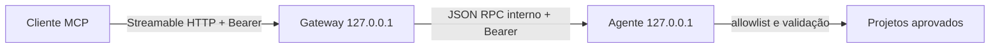

# Arquitetura

## Componentes nesta missão

O gateway mantém as nove ferramentas Nodaris e suas anotações somente leitura. O agente executa descoberta, leitura, pesquisa e consultas Git. Identificadores incluem `machineId` e `projectId`, ainda que a primeira execução seja local.

## Limites atuais

- Protocolo entre processos é HTTP JSON interno autenticado por bearer compartilhado; não é um protocolo público nem um contrato de implantação distribuída.
- O SDK MCP TypeScript v2 fornece handler Streamable HTTP sem estado.
- `NODARIS_ALLOWED_ROOTS` começa vazio. Não inferir permissão a partir do diretório do repositório Nodaris.
- Nova descoberta ocorre na inicialização do agente; reinicie após aprovar ou atualizar raízes.
- Symlinks são recusados. A API Node não oferece abertura relativa a descritores de diretório portável com garantia contra toda corrida TOCTOU; este risco residual exige endurecimento antes de ambientes hostis.

## Evolução multi-PC

Cada agente futuro terá identidade de máquina e canal autenticado próprio. O gateway deverá manter registro, estado e autorização de máquina/projeto. O Secure MCP Tunnel oferece acesso privado sem inbound público; não substitui autenticação entre processos nem a allowlist do agente. MetaMCP permanece uma hipótese para M03.

## Contrato

O schema do agente está em `packages/core/src/contracts.ts`. A API pública MCP está registrada em `apps/gateway/src/index.ts`. Alterações internas não renomeiam tools Nodaris sem ADR.
