<!-- SPDX-FileCopyrightText: 2026 Henrique Paiva Araujo -->
<!-- SPDX-License-Identifier: PolyForm-Noncommercial-1.0.0 -->

# M02.3B.1 — Spike de compatibilidade OAuth/MCP

**Estado:** pesquisa documental e harness sintético; nenhuma autenticação OAuth foi habilitada.<br>
**Data da consulta:** 16/10/2026.<br>
**Base:** `c537a1b3eef5b4224e12c4e501c00ad59f9d21e7`.<br>
**Escopo:** comparar Supabase Auth, Auth0 e Keycloak; fixar requisitos verificáveis para um futuro teste real; exercitar somente estruturas sintéticas em memória.

## 1. Conclusão executiva

**Candidato principal para avaliação em piloto: Supabase Auth OAuth Server, condicionado a um teste real controlado.** É o candidato com documentação direta de MCP, PRM/challenge, OAuth 2.1, PKCE e opções de cliente pré-registrado/DCR. Isso reduz incerteza documental, mas não prova que a configuração emitirá um token com `aud` exatamente igual ao resource Nodaris ou que o conjunto completo funcionará no ChatGPT. A documentação também exige que a aplicação hospede um authorization endpoint; o serviço sozinho não substitui o Control Plane.

**Alternativa: Auth0 Auth for MCP.** Há documentação oficial de CIMD, discovery e MCP. O parâmetro RFC 8707 `resource` precisa do Resource Parameter Compatibility Profile no tenant; sem isso a documentação de suporte registra fallback de audience para userinfo em fluxos DCR. Portanto, requer configuração e prova real específica antes de ser escolhido.

**Keycloak é a alternativa de maior controle operacional próprio**, sobretudo se hospedagem independente virar requisito. Para MCP 2026-07-28, Keycloak classifica Resource Indicators e CIMD como experimentais; a própria tabela de conformidade também classifica o suporte às versões 2025-11-25 e 2026-07-28 como experimental. Isso o torna menos indicado para o primeiro piloto do ChatGPT sem prova de compatibilidade e capacidade operacional.

Essas recomendações não autorizam criar conta, tenant, projeto, domínio, endpoint público ou gasto. Nenhum provedor foi configurado e nenhum OAuth real foi executado.

## 2. Base MCP/ChatGPT verificável

O perfil de referência é a especificação MCP mais recente publicada, `2026-07-28`, e o guia atual da OpenAI para autenticação de MCP plugins. A revisão também compara a versão `2025-11-25`, negociada pelo SDK instalado no Nodaris. A verificação de compatibilidade deve cobrir comportamento ponta a ponta, não apenas a presença de endpoints nos documentos do IdP.

| Requisito                           | Evidência/documento                                                                                                                                                  | Verificação exigida no teste real Nodaris                                                                                                                              |
| ----------------------------------- | -------------------------------------------------------------------------------------------------------------------------------------------------------------------- | ---------------------------------------------------------------------------------------------------------------------------------------------------------------------- |
| PRM e descoberta                    | MCP usa Protected Resource Metadata (RFC 9728); OpenAI exige PRM no resource server ou URL anunciada no desafio 401.                                                 | GET direto HTTPS ou descoberta via túnel suportado retorna resource canônico e authorization server esperado; request sem token recebe `401` com challenge para a PRM. |
| AS metadata e issuer                | OAuth AS metadata ou OIDC discovery; `issuer` deve corresponder exatamente à entrada `authorization_servers` da PRM.                                                 | Comparação byte a byte do issuer e teste de divergência, sem normalizar barra final, caixa, porta ou caminho.                                                          |
| `resource` e audience               | OpenAI espera `resource` tanto no authorize como no token request e que o valor seja refletido no token, em geral como `aud`.                                        | Capturar requests de teste no AS; validar token assinado pelo resource server com audience/resource exatos. Não basta o parâmetro ser aceito.                          |
| Authorization Code + PKCE           | ChatGPT usa code flow com PKCE e requer `S256` anunciado em `code_challenge_methods_supported`.                                                                      | Provar authorize/token real, `S256`, uso único do code e rejeição de verifier incorreto ou replay.                                                                     |
| Cliente                             | ChatGPT suporta CIMD, DCR ou cliente pré-registrado; MCP 2026-07-28 prioriza CIMD/pré-registro e mantém DCR para compatibilidade.                                    | Confirmar o modo escolhido, metadados de cliente, auth do token endpoint, allowlist exata de callback e política de registro. Nunca habilitar DCR aberto sem política. |
| Identificação do issuer na resposta | MCP 2026-07-28 recomenda `iss` e exige metadata `true` quando o AS o emite; o cliente compara literalmente quando presente. OpenAI usa callback estável se elegível. | Testar respostas de sucesso e erro, comparação literal e callback escolhido; não normalizar issuer.                                                                    |
| Scopes por ferramenta               | OpenAI documenta `securitySchemes` `oauth2`/`noauth` por ferramenta e erro MCP com `_meta["mcp/www_authenticate"]`.                                                  | Cada uma das ferramentas de leitura declara os escopos mínimos; resposta de scope insuficiente solicita autenticação sem revelar dados.                                |
| Token e chaves                      | Resource server valida assinatura, `iss`, `aud`/resource, `exp`, `nbf` e scopes. JWKS é fonte de chaves públicas e pode rotacionar.                                  | Testar chave atual/próxima, rotação com `kid`, cache e indisponibilidade JWKS; falhar fechado. Avaliar revogação efetiva além do vencimento do access token.           |
| Sessão e revogação                  | Refresh token e sessão são estados do provedor; não presumir revogação imediata de access token JWT já emitido.                                                      | Revogar consentimento/sessão e verificar comportamento real, TTL residual, refresh rotation e negação no Control Plane. Definir prazo aceitável antes do piloto.       |
| Contas/workspaces                   | OpenAI pode rotear ferramentas com a conexão autenticada selecionada; identidade corporativa depende de claims verificadas e configuração Workspace.                 | Dois subjects sintéticos e depois duas contas de teste devem permanecer isolados em cada chamada, grant e log. E-mail/nome não é chave de identidade.                  |
| URL/redirect                        | Metadados, resource, issuer e callback são identificadores de segurança.                                                                                             | Somente HTTPS público, URLs canônicas e callback exato pre-registrado; rejeitar HTTP, userinfo, fragmento, redirect aberto e descoberta ambígua.                       |

O `401` HTTP de descoberta do resource server não é o mesmo mecanismo que um erro de ferramenta já iniciado via MCP. O futuro gateway deverá atender ao formato correspondente em cada fronteira, de acordo com o fluxo efetivamente exigido pelo ChatGPT.

### Compatibilidade do SDK fixado

O `package.json` fixa `@modelcontextprotocol/node` **2.1.1**, `@modelcontextprotocol/server` e `@modelcontextprotocol/client` **2.3.1**; `pnpm-lock.yaml` confirma essas versões. A inspeção das declarações instaladas de `@modelcontextprotocol/server@2.3.1` confirma suporte parcial de resource server: `buildOAuthProtectedResourceMetadata`, `oauthMetadataResponse`, `getOAuthProtectedResourceMetadataUrl`, `requireBearerAuth` e `verifyBearerToken`, incluindo audience/resource, expiração, scopes e challenge Bearer. O tipo `AuthMetadataOptions` recebe metadata do AS e URL do resource; isso **não implementa o Authorization Server**, login, emissão de token ou registro de cliente. A aplicação ainda precisa fornecer um `OAuthTokenVerifier` confiável.

Há duas evidências distintas no conjunto fixado. O pacote `@modelcontextprotocol/server@2.3.1` é a linha v2 estável, cuja documentação oficial declara implementação da revisão MCP `2026-07-28`; porém, a inspeção do runtime instalado retorna `LATEST_PROTOCOL_VERSION=2025-11-25` e `SUPPORTED_PROTOCOL_VERSIONS` até essa revisão. O gateway Nodaris usa `createMcpHandler` e `toNodeHandler`, e a chamada efetiva atual negocia a era legada `2025-11-25`; isso não demonstra que a configuração atual do gateway use a implementação moderna. Assim, o suporte do pacote a APIs modernas é documentado, mas a compatibilidade da integração/transport atual com `2026-07-28` permanece **NOT_VERIFIED**. O harness deste spike não negocia nem simula compatibilidade protocolar. Não atualizar o SDK automaticamente: o próximo gate deverá comparar opções em ambiente isolado, sem pressupor que upgrade seja obrigatório.

O gateway atual em `apps/gateway/src/index.ts` continua usando `createMcpHandler`, `toNodeHandler` e Bearer compartilhado próprio; não usa esses helpers, não anuncia OAuth e não declara `securitySchemes` por ferramenta. Não localizei `securitySchemes` nas declarações públicas de `@modelcontextprotocol/server@2.3.1`; a capacidade do protocolo/OpenAI está documentada, mas seu suporte pela API pública deste SDK fixado não foi verificado. Logo **SDK_RESOURCE_SERVER_HELPERS=SUPPORTED**, **SDK_MODERN_PROTOCOL_PACKAGE=DOCUMENTED**, **SDK_CURRENT_GATEWAY_PROTOCOL=2025-11-25** e **SDK_TOOL_SECURITY_SCHEMES=NOT_VERIFIED**. Não houve atualização de protocolo nem SDK. As nove ferramentas M01 permanecem somente leitura e não receberam alterações.

As versões existentes no `package.json`/`pnpm-lock.yaml` são `@modelcontextprotocol/node@2.1.1` e `@modelcontextprotocol/server@2.3.1`/`client@2.3.1`; os manifests instalados declaram Apache-2.0. Não foram adicionadas dependências. A release oficial 2.3.1 é a origem consultada para versões e mudanças publicadas; esta inspeção do lockfile e changelog não equivale a uma busca completa de CVEs/advisories ou auditoria de supply chain, que segue pendente para o gate M02.3B.2.

## 3. Avaliação de provedores

Legenda: **SUPPORTED** = documentação específica cobre o recurso; **REQUIRES_CONFIGURATION** = depende de configuração/integração indicada; **EXPERIMENTAL** = o provedor classifica explicitamente assim; **NOT_VERIFIED** = documentação consultada não prova o comportamento necessário ao Nodaris. Status não equivale a ensaio real.

| Capacidade                     | Supabase Auth OAuth Server                                                                                                                   | Auth0 Auth for MCP                                                                                                                                      | Keycloak self-hosted                                                                                                                   |
| ------------------------------ | -------------------------------------------------------------------------------------------------------------------------------------------- | ------------------------------------------------------------------------------------------------------------------------------------------------------- | -------------------------------------------------------------------------------------------------------------------------------------- |
| OAuth 2.1 / OIDC               | **SUPPORTED** — OAuth 2.1 e discovery MCP documentados.                                                                                      | **SUPPORTED** — Auth for MCP documenta OAuth 2.1/OIDC.                                                                                                  | **SUPPORTED** — docs de conformidade indicam OAuth 2.1 e OIDC.                                                                         |
| Authorization Code + PKCE S256 | **SUPPORTED** em documentação OAuth/MCP; verificar configuração do cliente no teste.                                                         | **SUPPORTED** para aplicações de terceiros e fluxo MCP documentado; conferir metadata concreta.                                                         | **SUPPORTED** como capacidade do servidor; conferir cliente e realm.                                                                   |
| PRM e challenge MCP            | **SUPPORTED** pelo middleware `withOAuthProtectedResource()` em cenário de aplicação documentado.                                            | **REQUIRES_CONFIGURATION** no resource server Nodaris; Auth0 é o AS e não substitui o endpoint PRM do servidor por si só.                               | **REQUIRES_CONFIGURATION** no resource server Nodaris; MCP especifica PRM para o MCP server, não o AS.                                 |
| AS Metadata / discovery        | **SUPPORTED** — URL de discovery documentada.                                                                                                | **SUPPORTED** — discovery e metadata MCP documentadas.                                                                                                  | **SUPPORTED** — RFC 8414/OIDC Discovery listados.                                                                                      |
| CIMD                           | **NOT_VERIFIED** nas páginas MCP/OAuth consultadas para Supabase; não inferir do OAuth genérico.                                             | **SUPPORTED** na guia OpenAI/Auth0, condicionado a cliente CIMD/manual e configuração do tenant.                                                        | **EXPERIMENTAL** — feature `cimd` e client policy precisam ser habilitadas.                                                            |
| DCR / cliente pré-registrado   | **SUPPORTED** como opção — DCR exige habilitação e a documentação recomenda aprovação/monitoramento; pré-registro documentado.               | **SUPPORTED/REQUIRES_CONFIGURATION** — cliente pode ser importado/registrado via CIMD; DCR e controles de apps terceirizados dependem da política.      | **SUPPORTED** para pré-registro/DCR; MCP 2026-07-28 recomenda CIMD e mantém DCR por compatibilidade. DCR anônimo deve ser restringido. |
| `resource` RFC 8707 e audience | **NOT_VERIFIED** para audience exata no token Nodaris com ChatGPT. Deve ser prova obrigatória; documentação MCP não demonstra o claim final. | **REQUIRES_CONFIGURATION** — ativar Resource Parameter Compatibility Profile; sem isso, há fallback documentado para userinfo audience em caso MCP/DCR. | **EXPERIMENTAL** para Resource Indicators em 2026-07-28; audience mapper/allowlist configurados por resource.                          |
| RFC 9207 `iss`                 | **NOT_VERIFIED** nas páginas MCP/OAuth examinadas.                                                                                           | **NOT_VERIFIED** para resposta em todos os casos de sucesso/erro no fluxo ChatGPT; testar.                                                              | **SUPPORTED** na tabela de conformidade atual consultada; validar emissão concreta no realm.                                           |
| JWKS / rotação                 | **REQUIRES_CONFIGURATION** — validar claims e comportamento de rotação/refresh na integração.                                                | **SUPPORTED** como plataforma OIDC, mas cache/rotação e comportamento do resource Nodaris precisam de teste.                                            | **SUPPORTED** como capability OIDC; Nodaris ainda precisa implementar verifier e política de cache/rotação.                            |
| Scopes/refresh/revogação       | **REQUIRES_CONFIGURATION** — implementar endpoint/app e política; revogação imediata de JWT não presumida.                                   | **REQUIRES_CONFIGURATION** — configurar API/scopes e testar revogação/TTL residual.                                                                     | **REQUIRES_CONFIGURATION** — realm, client scopes, sessão, política e operação são responsabilidade do operador.                       |
| Multiusuário/equipes           | **REQUIRES_CONFIGURATION** — identidade user suportada; modelo de equipe/grants Nodaris segue necessário.                                    | **SUPPORTED** para Organizations/RBAC conforme plano/configuração, mas grants Nodaris e isolamento por ferramenta seguem próprios.                      | **SUPPORTED** para realms/groups/roles configuráveis; tenancy e grants de projeto Nodaris continuam próprios.                          |
| Windows/macOS/Linux            | **SUPPORTED** como serviço remoto consumido por HTTPS; o agente multiplataforma ainda é trabalho Nodaris.                                    | **SUPPORTED** como serviço remoto consumido por HTTPS; não resolve adaptadores locais Nodaris.                                                          | **SUPPORTED** em operação própria multiplataforma, mas instalação/backup/upgrade/HA precisam ser operados.                             |

### Custo e esforço operacional (estimativa de referência)

Valores consultados em páginas oficiais em 16/10/2026, USD e sujeitos a alteração, região, impostos, contrato e uso:

| Opção    | Referência pública observada                                                                                                                                                                                                   | Custo que não está incluído/confirmado                                                                                                                                                 |
| -------- | ------------------------------------------------------------------------------------------------------------------------------------------------------------------------------------------------------------------------------ | -------------------------------------------------------------------------------------------------------------------------------------------------------------------------------------- |
| Supabase | Free: US$ 0, quota publicada de até 50 mil MAU; projetos Free podem pausar por inatividade. Pro: desde US$ 25/mês, 100 mil MAU incluídos; compute adicional, egress e uso podem alterar o total.                               | Hospedagem do Control Plane/MCP e endpoint de autorização do app, domínio, observabilidade, egress excedente e eventuais recursos de equipe/SSO. O custo total Nodaris não foi cotado. |
| Auth0    | Página consultada apresenta Free US$ 0 até 25 mil MAU; Essentials exibido a partir de US$ 35/mês e Professional a partir de US$ 240/mês nos limites e critérios do estimador mostrado. Planos B2B/Enterprise e add-ons variam. | Plano que cubra Organizations/RBAC, quotas, recursos avançados e preço final. A página é dinâmica; obter cotação/confirmar termos no momento da decisão.                               |
| Keycloak | Software self-hosted sem tarifa de licença do produto presumida nesta comparação.                                                                                                                                              | Infraestrutura, banco, TLS/domínio, disponibilidade, backup/restore, monitoramento, patching, atualização e horas de operação; não estimados.                                          |

Não há comparação monetária total ou compromisso de serviço. As páginas de preço são snapshots, não orçamento. Fontes de custo: [Supabase Pricing](https://supabase.com/pricing), [Billing FAQ Supabase](https://supabase.com/docs/guides/platform/billing-faq) e [Auth0 Pricing](https://auth0.com/pricing).

Nenhuma versão de servidor/tenant foi escolhida ou instalada, então não foi criado lock de versão de provedor. Esta pesquisa não constitui auditoria completa de advisories/CVEs, SBOM ou histórico de incidentes dos fornecedores. Antes da integração, fixar a versão implantada quando aplicável e revisar release support, advisories, dependências, licença e política de atualização do produto efetivamente selecionado.

## 4. Arquitetura candidata para Nodaris

```mermaid
flowchart LR
  C[ChatGPT] -->|OAuth individual, Bearer por usuário| R[Resource Server MCP via HTTPS direto ou Tunnel]
  R -->|identidade verificada + pedido autorizado| CP[Control Plane: metadata, grants e auditoria]
  CP -->|canal de saída autenticado por dispositivo| B[Broker/roteamento privado a validar]
  B --> A[Agente Nodaris local]
  A --> W[Workspace permitido localmente]
  AS[Authorization Server / IdP] -->|authorize, token, discovery, JWKS| C
  R -. PRM e challenge 401 .-> C
```



Fronteiras que precisam permanecer independentes:

1. **Pessoa:** `issuer + subject` validado pelo AS; nome e e-mail são atributos, não ID principal.
2. **Instalação/device solicitante:** identidade criptográfica distinta, chave privada local e rotação/revogação próprias.
3. **Equipe/workspace:** membership e papel não concedem acesso a disco automaticamente.
4. **Grant de projeto:** autorização específica por workspace/cópia de repositório e operação, verificada por chamada.
5. **Consentimento local:** aprovação explícita do proprietário do host, independente de consentimento OAuth.
6. **Transporte:** túnel/broker de saída autenticado por device não substitui OAuth da pessoa nem policy do agente.

O Secure MCP Tunnel validado na M01 permanece intacto. A documentação oficial atual confirma que a descoberta OAuth/PRM pode trafegar pelo túnel e que ele preserva metadata do authorization server upstream; o resource server pode permanecer privado. O AS **não é tunelado automaticamente**: precisa ser alcançável pelo navegador/cliente e pelo caminho exigido pelo fluxo. O túnel é transporte, não substituto do IdP nem prova de que qualquer configuração OAuth do Nodaris funcionará. A identidade canônica do resource, a propagação exata de `resource`/audience pela rota tunnel-backed, callbacks e comportamento do ChatGPT ainda exigem teste real. **OAUTH_OVER_EXISTING_TUNNEL=PARTIAL; RESOURCE_AUDIENCE_THROUGH_TUNNEL=NOT_VERIFIED.** Não abrir portas no computador. Para distribuição de plugin público, a documentação separa esse cenário do túnel privado e requer endpoint MCP HTTPS público; isso não deve ser confundido com o ensaio privado já validado na M01.

## 5. Threat model resumido

| Ameaça                                           | Controle exigido antes do piloto                                                                                                                                         |
| ------------------------------------------------ | ------------------------------------------------------------------------------------------------------------------------------------------------------------------------ |
| Token válido para outra API/resource             | Validar assinatura, `iss`, `aud` exato/resource, `exp`, `nbf`, scopes e algoritmo; negar falta/ambiguidade.                                                              |
| Confusão de issuer ou metadata                   | HTTPS, issuer exato sem normalização, `iss` RFC 9207 coerente quando anunciado; rejeitar múltiplos AS não selecionados e redirects de descoberta.                        |
| Cliente OAuth não autorizado/DCR aberto          | Preferir CIMD quando validado; se DCR, exigir aprovação/política, allowlist callback/redirect e monitorar registro. Nunca usar client secret exposto em cliente público. |
| Reuso de token/refresh e revogação atrasada      | TTL curto definido por risco; rotação de refresh; estado/epoch/revogação no Control Plane; bloquear se estado não puder ser confirmado quando a política exigir.         |
| Troca de conta ou confusão de equipe             | Contexto autenticado associado a cada pedido; chave humana `(issuer, subject)`; workspace/team/grant separados e testados com dois usuários.                             |
| IdP indisponível ou chave rotacionada            | Cache JWKS limitado e regras claras; novas decisões fail-closed em estado inconclusivo; observabilidade sem tokens/PII.                                                  |
| Bypass do túnel ou origem pública local          | Nenhuma porta pública no host; agente mantém allowlist/consentimento local; canal device autenticado; autorização aplicada antes do roteamento.                          |
| Ferramenta de escrita exposta por erro de policy | M01 permanece read-only; no piloto, ferramentas existentes e scopes apenas de leitura; validação estática de catálogo e E2E.                                             |
| SSRF em CIMD/discovery/redirect                  | Fetcher com allowlist de esquemas/hosts, sem IP privado/link-local, sem redirect não validado; timeout/limite; não buscar URLs fornecidas livremente.                    |

## 6. Harness e limites da evidência

`tests/fixtures/oauth-mcp/compatibility-harness.ts` contém somente valores sintéticos e validadores de fixture puros; não abre sockets, não chama rede, não valida assinatura JWT e não é importado pela produção. `tests/oauth-mcp-compatibility.test.ts` cobre metadata PRM/AS, issuer, URLs HTTPS canônicas, PKCE S256 anunciado, opções de registro (CIMD/DCR/pré-registro), resource nos dois pedidos, audience, expiração, scopes, challenge 401, redirect exato, rejeição de metadata ambígua, inventário das nove tools read-only e ausência de credenciais.

Os testes provam somente a lógica do harness sobre fixtures. **Não provam** comportamento de um provedor, PKCE real entre navegador e token endpoint, criptografia/JWT/JWKS, rotação, revogação online, isolamento de tenant real, conformidade do ChatGPT, configuração de tool-level `securitySchemes` no SDK atual nem operação do Secure MCP Tunnel com rotas públicas de OAuth. Não foi iniciado endpoint simulado porque não é necessário para as estruturas em memória; nenhum endpoint real foi contatado pelos testes.

## 7. Plano do primeiro teste OAuth real (missão futura)

1. Obter aprovação do proprietário para o IdP, plano/custo máximo, ambiente de teste, domínio/HTTPS e responsável pelos dados. Não usar projetos/contas já existentes sem autorização explícita.
2. Criar tenant/projeto descartável só após autorização, sem dados pessoais reais; criar duas identidades de teste separadas e um cliente MCP com callback exato mostrado pelo ChatGPT.
3. Hospedar em ambiente isolado um MCP resource server de leitura mínima e metadata PRM; manter o device Nodaris fora de rede pública e usar um agente fake sem filesystem real, ou fixture somente de teste.
4. Testar GET PRM, 401 challenge, AS metadata, issuer exato, CIMD/DCR/pré-registro escolhido, `iss` em sucesso/erro, PKCE S256 e resource nos dois requests.
5. Decodificar/validar em ambiente de teste o token recebido sem registrar token: assinatura/JWKS, `iss`, audience/resource, `exp`, scopes e subject; confirmar negação ao alterar cada claim.
6. Instalar no ChatGPT de teste e confirmar linking, consentimento, primeira chamada read-only, troca entre as duas contas e ausência de vazamento cruzado. Registrar só status, timestamps e códigos não sensíveis.
7. Revogar grant e refresh/session, testar renovação/TTL e atraso residual; exercitar rotação JWKS com chave overlap e indisponibilidade do IdP. Encerrar contas/recursos e conferir custos.
8. Revisão de segurança independente antes de qualquer conexão ao agente real. O piloto Nodaris só roteia a projetos após consentimento local, device auth e grant por projeto estarem implementados e revisados.

Critérios de PASS futuro: ChatGPT faz code flow real com PKCE; audience/resource exatos; validação server-side; duas contas isoladas; grants mínimos; revogação demonstrada dentro do SLA aprovado; nenhuma escrita; nenhuma porta de entrada no PC; logs sanitizados. Falha em issuer, audience, resource, PKCE, redirect ou isolamento é bloqueador.

## 8. Próximo gate: M02.3B.2 — SDK MCP Compatibility Gate

Antes de qualquer OAuth real, uma missão isolada deverá verificar a integração MCP atual e alternativas de SDK/transport. O gate deve:

1. Reproduzir em fixture a negociação da revisão MCP pelo caminho HTTP atualmente usado pelo gateway, distinguindo o pacote `server` v2, o adaptador Node e o handler efetivamente selecionado.
2. Verificar na API pública instalada se `securitySchemes` e `_meta["mcp/www_authenticate"]` podem ser representados e enviados nos formatos exigidos pelo ChatGPT; registrar como `SUPPORTED`, `UNSUPPORTED` ou `NOT_VERIFIED` com teste e declaração como evidência.
3. Comparar, em projeto descartável e sem conectar ao runtime M01, manter o caminho existente, usar APIs modernas do SDK fixado ou avaliar alternativa compatível. Cobrir breaking changes, manutenção, licença, dependências, advisories/supply chain e custo de migração.
4. Não atualizar dependências, lockfile, gateway, agente ou runtime M01 nessa etapa; qualquer alteração de produção exige autorização e publicação separadas.
5. Entregar uma decisão técnica recomendada, limitações e plano de teste; não habilitar OAuth nem escolher/provisionar um provedor.

O gate não presume que seja necessário atualizar o SDK. A adoção de uma versão ou caminho diferente só poderá ser recomendada se a incompatibilidade for demonstrada na integração efetivamente usada e a alternativa passar pelos testes isolados e revisão de segurança.

## 9. Decisões e pendências do proprietário

- Aprovar candidato IdP (a recomendação Supabase é apenas para avaliação), alternativa e custo mensal máximo.
- Decidir se o teste real pode criar domínio/endpoint HTTPS e qual operador hospedará MCP Resource Server/Control Plane/AS.
- Definir se o primeiro teste real é só com mocks/identidades de teste ou conta de teste de proprietário, e política de retenção/exclusão.
- Aprovar modo de registro ChatGPT (CIMD, DCR restrito ou cliente pré-registrado) após prova no tenant escolhido.
- Definir scopes mínimos, duração máxima de tokens e SLA para revogação/offline.
- Decidir se identidade de equipes entra no piloto; nenhum papel de equipe pode conceder acesso local sem grant e consentimento do host.
- Aprovar quando discutir integração à M01; esta missão não altera Bearer, túnel, entrypoints, catálogo, SDK ou produção.

## 10. Referências oficiais consultadas

1. [OpenAI — Authentication for MCP plugins](https://developers.openai.com/plugins/build/auth) — PRM, AS metadata, `resource`, PKCE, client registration, RFC 9207, `securitySchemes`, validação de token. Consultado em 16/10/2026.
2. [OpenAI — Secure MCP Tunnel](https://developers.openai.com/api/docs/guides/secure-mcp-tunnels) — resource privado, descoberta OAuth pelo túnel, metadata upstream e AS não tunelado automaticamente. Consultado em 16/10/2026.
3. [MCP — Authorization, versão 2026-07-28](https://modelcontextprotocol.io/specification/2026-07-28/basic/authorization) — revisão atual de autorização, CIMD/pré-registro, Resource Indicators e RFC 9207. Consultado em 16/10/2026.
4. [Supabase — MCP Authentication](https://supabase.com/docs/guides/auth/oauth-server/mcp-authentication) e [OAuth flows](https://supabase.com/docs/guides/auth/oauth-server/oauth-flows) — pré-requisitos, discovery, PKCE, DCR/pré-registro e middleware. Consultados em 16/10/2026.
5. [Supabase — Deploy MCP servers](https://supabase.com/docs/guides/ai-tools/byo-mcp) — exemplo de host MCP em Edge Function. Consultado em 16/10/2026.
6. [Supabase pricing](https://supabase.com/pricing) e [billing FAQ](https://supabase.com/docs/guides/platform/billing-faq) — referências de preço/compute. Consultados em 16/10/2026.
7. [Auth0 — Auth for MCP](https://auth0.com/ai/docs/mcp/overview), [OpenAI/Auth0 MCP scaffold guide](https://github.com/openai/openai-mcpkit/blob/main/python-authenticated-mcp-server-scaffold/README.md) e [Resource Parameter Compatibility Profile](https://support.auth0.com/center/s/article/mcp-audience-error-with-auth0) — CIMD, grants, resource/audience e configuração. Consultados em 16/10/2026.
8. [Auth0 pricing](https://auth0.com/pricing) — estimador/plano público dinâmico. Consultado em 16/10/2026.
9. [Keycloak — MCP authorization server](https://www.keycloak.org/securing-apps/mcp-authz-server) — tabela de conformidade, Resource Indicators, audience e CIMD experimental. Consultado em 16/10/2026.
10. [MCP TypeScript SDK — release 2.3.1](https://github.com/modelcontextprotocol/typescript-sdk/releases/tag/v2.3.1) — versão publicada e notas de release. Consultado em 16/10/2026.

## 11. Resultado do spike

```text
M02_3B_OAUTH_SPIKE=PARTIAL
PROVIDER_COMPARISON=PASS
OPENAI_MCP_COMPATIBILITY_RESEARCH=PASS
LOCAL_OAUTH_FIXTURES=PASS
OAUTH_SECURITY_TESTS=PASS
PROVIDER_RECOMMENDATION=READY_FOR_OWNER_REVIEW
REAL_CHATGPT_OAUTH=NOT_TESTED
PRODUCTION_AUTH=NOT_ENABLED
M01_RUNTIME_PRESERVED=YES
PUBLICATION=PENDING
```

As classificações acima descrevem pesquisa e testes sintéticos apenas. Não indicam aprovação do proprietário, integração de produção, escolha definitiva de provedor, validação real do ChatGPT ou início da M02.3B.2/M02.4.
