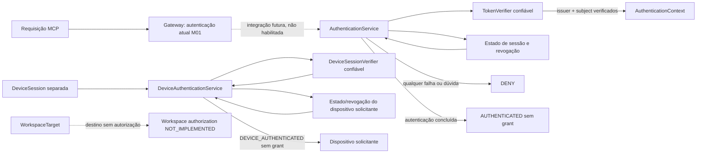
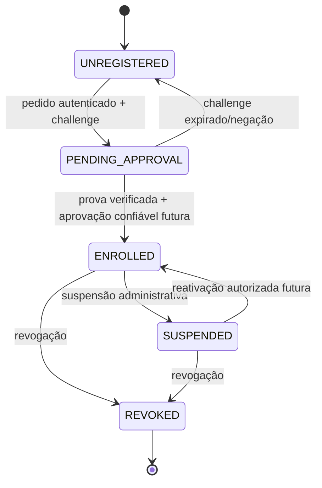
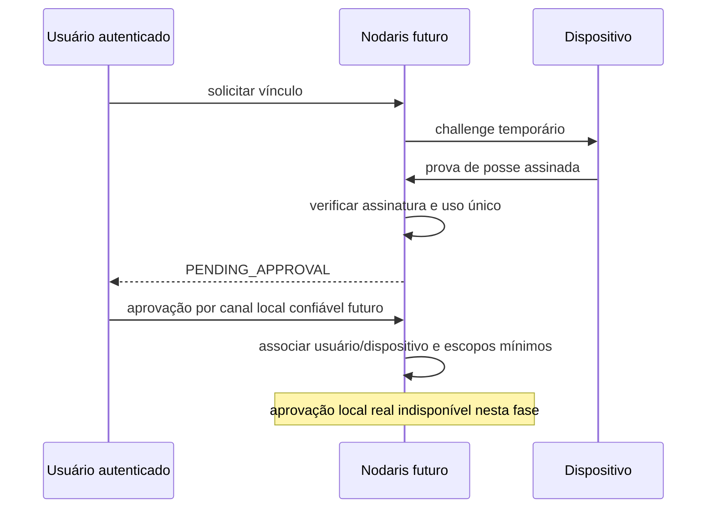

<!-- SPDX-FileCopyrightText: 2026 Henrique Paiva Araujo -->
<!-- SPDX-License-Identifier: PolyForm-Noncommercial-1.0.0 -->

# Fundação de identidade, sessão e dispositivos — M02.3A

## Estado e limites

Esta entrega cria contratos TypeScript e uma política de composição isolada. Não há provedor OAuth/OIDC,
verificação criptográfica JWT, endpoint de enrollment, armazenamento persistente de identidade,
aprovação local confiável, Control Plane, credencial real ou integração nos entrypoints de produção.
Os módulos novos não são importados pelo agente ou gateway. A política só é exercitada com fakes em
memória nos testes. Ela não constitui autenticação utilizável em produção.

O Bearer compartilhado, o Secure MCP Tunnel, o supervisor Windows, a raiz aprovada e as nove
ferramentas MCP de leitura da M01 permanecem sem alteração. A M01 não fornece identidade individual.

## Modelo de identidade e confiança

`UserIdentity` é o par exato `(issuer, subject)` produzido por um verificador confiável. Nome, e-mail,
username, texto do prompt, identificador fornecido pelo modelo, `userId`, `deviceId` ou flags como
`authenticated=true` e `signatureValid=true` não comprovam identidade. Claims de perfil ficam
separadas como dados declarados.

`AuthenticationService` recebe somente uma credencial opaca e um nonce de operação opcional. Issuer,
audience, resource, escopos, tolerância de relógio e fonte de tempo vêm da composição confiável no
servidor. O serviço consulta `TokenVerifier` e o estado da sessão; não usa identidade de dispositivo
nem verifica propriedade do computador-alvo. Erro, estado ausente ou resultado inconclusivo nega.
Os contratos TypeScript, inclusive `outcome: VERIFIED`, não provam criptografia: uma composição
futura precisa instalar um adaptador verificador confiável e nunca aceitar resultado fabricado pelo
request. Nenhum adaptador de produção existe nesta fase.

### Três principais distintos

| Principal/referência    | Significado                                                                                                     | O que não prova                                                                                |
| ----------------------- | --------------------------------------------------------------------------------------------------------------- | ---------------------------------------------------------------------------------------------- |
| Usuário autenticado     | Pessoa representada por `issuer + subject` validados por OAuth/OIDC.                                            | Propriedade, enrollment ou grant em qualquer computador.                                       |
| Dispositivo solicitante | Instalação Nodaris que pode provar posse de chave e autenticar separadamente por `DeviceAuthenticationService`. | Identidade humana, consentimento ou acesso ao workspace.                                       |
| Dispositivo-alvo        | Host indicado por `WorkspaceTarget` onde reside o projeto.                                                      | Que o usuário ou o dispositivo solicitante é proprietário; não é autorizado por esta fundação. |

Exemplo: João pode ter autenticação individual válida enquanto Maria possui o host. A identidade de
João não se converte em identidade do dispositivo, e a identidade do host não exige que João seja
proprietário. Isso tampouco concede acesso: `WORKSPACE_AUTHORIZATION_STATUS` é
`NOT_IMPLEMENTED`; ainda não existe ProjectGrant, política de equipe ou decisão de acesso ao projeto.
M02.3B (provedor/identidade), M02.4 (aprovação local e ciclo de vida de dispositivo, sujeito a
decisão) e M02.7 (grants/roteamento conforme blueprint) são dependências futuras, não iniciadas.

## Sessões e decisões

`UserSession` representa status `ACTIVE`, `EXPIRED`, `REVOKED`, `INVALID` ou `INCONCLUSIVE`,
issuer, audience, escopos, validade, epoch e referência de revogação. A política confiável impõe
expiração, `not-before`, audience e resource exatos, issuer exato, escopos pedidos, relógio injetado
e tolerância limitada a no máximo 120 segundos. Política vazia/ambígua, sessão revogada ou abaixo do
epoch mínimo, estado ausente e falha do verificador resultam em `DENY`. `AUTHENTICATED` significa
somente que identidade e condições de autenticação configuradas foram verificadas; não autoriza
ler, pesquisar ou acessar qualquer workspace.

A renovação futura deverá revalidar a identidade e a sessão, rotacionar refresh tokens no provedor e
aplicar revogação/epoch. Replay deve ser prevenido pelo provedor e por identificadores de operação ou
nonce de uso único onde o protocolo exigir; a fundação não persiste jti, nonces ou revoga tokens.
Não há autorização para escrita: capacidades `workspace.write.approved` e `test.run.approved`
continuam negadas pelo helper compartilhado de capacidades.

## Dispositivo, enrollment e revogação

`DeviceIdentity` é distinto do usuário e prevê chave pública assimétrica (`Ed25519` ou `ES256`),
versão de chave e status, sem campo de proprietário implícito. `DeviceSession` e
`DeviceAuthenticationService` autenticam separadamente a instalação solicitante com um verificador
confiável, escopos, recurso, validade e estado. `DEVICE_AUTHENTICATED` confirma apenas a identidade
criptográfica da instalação; não concede grant nem acesso ao dispositivo-alvo. A chave privada deve
ser gerada e permanecer no dispositivo em cofre local adequado, numa implementação futura.
Serial/UUID de hardware não é identidade. `DeviceProofOfPossession` descreve prova sobre challenge,
mas este repositório não verifica assinatura.

Fluxo futuro: usuário autenticado solicita enrollment; serviço emite nonce curto vinculado ao pedido,
dispositivo e chave; dispositivo assina o challenge; verificador valida prova e uso único; um
aprovador autorizado do host consente por canal local confiável; o registro associa as identidades
sem presumir que usuário e proprietário sejam a mesma pessoa e emite sessão de escopo/vida mínimos.
Challenge respondido prova posse da chave (quando verificada), não consentimento do proprietário.
Nesta fundação, aprovação local é sempre `INCONCLUSIVE`; a fixture só demonstra challenge em memória,
expiração, uso único e indisponibilidade offline.

Revogação futura deve invalidar o device grant, sessões associadas e epochs, rejeitar novos pedidos
imediatamente dentro do objetivo operacional definido e não depender apenas do vencimento do access
token. `DeviceAuthenticationService` nega dispositivo não registrado, pendente, suspenso ou revogado
e epoch antigo. Quando o Control Plane estiver offline ou a leitura de estado não puder confirmar
revogação, a decisão é negar; não há cache permissivo neste modelo.

## OAuth/OIDC para MCP e ChatGPT

A implementação futura deve preferir um provedor estabelecido e suportar o perfil MCP/OAuth atual:

- Protected Resource Metadata no recurso MCP, com identificador canônico HTTPS e authorization
  server(s), além de desafio `401`/`WWW-Authenticate` que direcione à metadata.
- Authorization Server Metadata/descoberta OIDC coerente com o issuer exato e endpoints necessários.
- Authorization Code + PKCE `S256`; não usar implicit ou client-credentials para representar o usuário.
- Preservar e ecoar o parâmetro `resource` no fluxo e vincular o token ao recurso (audience); conferir
  assinatura, issuer, audience/resource, `exp`, `nbf`, subject, escopos e política de sessão em cada
  requisição protegida.
- Escolher CIMD, DCR ou cliente pré-registrado conforme suporte concreto do provedor e do cliente
  OpenAI; publicar métodos de autenticação de token aceitos e não presumir que DCR anônimo é seguro.
- Emitir desafios MCP compatíveis e manter a autenticação por ferramenta/servidor alinhada à política.

O guia atual da [OpenAI para autenticação MCP](https://developers.openai.com/plugins/build/auth)
descreve PRM, metadata do authorization server, propagação de `resource`, CIMD/DCR/pré-registro,
PKCE S256, `WWW-Authenticate`, validação de tokens no resource server e limitações do cliente.
O servidor precisa verificar o token por requisição; o cliente e o modelo não substituem esse controle.
Consultar também a [especificação de autorização MCP](https://modelcontextprotocol.io/specification/2025-11-25/basic/authorization)
antes da implementação e fixar a revisão normativa usada na missão de integração.

## Comparação preliminar de provedores

Avaliação documental em 15/10/2026. Capacidades, preços e disponibilidade mudam; compatibilidade
específica precisa de spike em ambiente de teste. Nenhuma escolha foi aprovada.

| Opção                      | MCP/ChatGPT, metadata e cliente                                                                                                                                                                                | PKCE, resource/audience e tokens                                                                                                         | Chaves, revogação e operação                                                                                                                                       | Custo e pendências                                                                                                                                                                    |
| -------------------------- | -------------------------------------------------------------------------------------------------------------------------------------------------------------------------------------------------------------- | ---------------------------------------------------------------------------------------------------------------------------------------- | ------------------------------------------------------------------------------------------------------------------------------------------------------------------ | ------------------------------------------------------------------------------------------------------------------------------------------------------------------------------------- |
| Auth0                      | A documentação da OpenAI indica guia MCP Auth0; CIMD/DCR e PRM precisam ser confirmados no tenant/plano escolhido.                                                                                             | PKCE disponível; Auth0 pode exigir perfil de compatibilidade para mapear `resource` para audience; testar fluxo e token real em sandbox. | Serviço gerenciado reduz operação de issuer/JWKS; access token costuma exigir TTL curto e política adicional para revogação rápida.                                | Página de preços apresenta tiers e quotas variáveis por plano/uso. Compatibilidade exata, custos Nodaris, claims de device/session e revogação imediata: **NOT_VERIFIED**.            |
| Supabase Auth OAuth Server | Documentação Supabase agora descreve autenticação MCP, Protected Resource Metadata, challenge e opção DCR ou pré-registro. Validar aderência exata a ChatGPT/CIMD e configuração do resource no endpoint real. | OAuth 2.1 code+PKCE e refresh; integração de MCP é documentada. Verificar audience/resource e scopes emitidos e conferidos pelo Nodaris. | JWT/JWKS e gestão gerenciada; validar propagação de revogação, cache, epoch e associação a dispositivo. Implementação de app ainda exige integração.               | Preços publicados incluem plano gratuito e Pro; eventual compute, MAU, egress e demais limites podem acrescentar custo. Custo real, SLA e requisitos de identidade: **NOT_VERIFIED**. |
| Keycloak (self-hosted)     | Documenta autorização MCP, CIMD (experimental conforme feature/configuração), DCR e pré-registro; exige configuração explícita de políticas.                                                                   | Suporte OIDC/OAuth e PKCE; validar `resource` audience mapper e fluxo ChatGPT em spike próprio.                                          | Mais controle sobre sessão, chaves e instalação, com operação de banco, upgrades, backup, monitoramento, disponibilidade e segurança sob responsabilidade Nodaris. | Sem taxa de licença de software presumida nesta análise; custo de infraestrutura e operação não estimado. CIMD específico/versão e suporte operacional: **NOT_VERIFIED**.             |

Fontes oficiais consultadas: [guia Auth0 de autorização MCP pela OpenAI](https://developers.openai.com/plugins/build/auth),
[OAuth MCP do Supabase](https://supabase.com/docs/guides/auth/oauth-server/mcp-authentication),
[fluxos OAuth 2.1 do Supabase](https://supabase.com/docs/guides/auth/oauth-server/oauth-flows),
[guia MCP do Keycloak](https://www.keycloak.org/securing-apps/mcp-authz-server),
[preços Auth0](https://auth0.com/pricing),
[preços Supabase](https://supabase.com/pricing) e
[comportamento Auth0 para parâmetro `resource`](https://support.auth0.com/center/s/article/mcp-audience-error-with-auth0).

## Isolamento e testes

Contratos em `packages/core/src/identity/` não são importados pelos entrypoints ativos. Fakes em
`tests/fixtures/identity/` usam dados fictícios e memória. `tests/identity-foundation.test.ts` cobre
negação por issuer/audience/resource/expiração/not-before/escopo/verificador inconclusivo ou
indisponível, política/entrada ambígua, claims fabricadas, sessão revogada/epoch antigo,
autenticação humana sem enrollment do host-alvo, identidade de dispositivo independente, estados de
dispositivo negados, replay, challenge expirado/reutilizado/offline e ausência de aprovação local ou
grant de workspace efetivo.

Os testes TypeScript não provam assinatura criptográfica, claims fornecidas por um issuer real,
isolamento de processo, persistência, revogação online nem resistência a ataques de infraestrutura.
Não são executados contra o agente/gateway da M01. A compatibilidade MCP é verificada separadamente
pelos testes existentes; nenhum schema, nome de ferramenta ou anotação é alterado.

## Gates para M02.3B

Antes de escolher ou integrar um provedor: aprovar provedor e modelo de custo; spike oficial de
PRM/AS metadata, ChatGPT e CIMD/DCR/pré-registro; decidir sessão, revogação e política offline;
especificar device-key provisioning, proteção de chave, consentimento local verificável, recuperação
e rotação; threat model e revisão independente; definir scopes mínimos e política de grants; selecionar
biblioteca de validação mantida com licença/versão/histórico de segurança revistos; configurar ambiente
de teste sem credenciais reais do proprietário; aprovar migração que preserve o Bearer M01 durante
transição. Até esses gates, M01 continua sendo a única composição operacional e não há autenticação
individual ou vínculo de dispositivo ativo.
