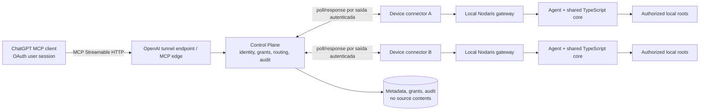

# Nodaris — blueprint da M02: multiplataforma, identidade e equipes

**Estado:** proposta arquitetural da M02.1; não implementada<br>
**Base M01:** `0655c7245ac4d24b3bcd9a547d637fd7b8e45920`<br>
**Escopo deste documento:** desenho, decisões propostas, riscos e critérios de evolução. Não provisiona infraestrutura nem altera o runtime.

## 1. Resumo e princípios

A M01 é uma instalação funcional de um computador, com agente e gateway locais, nove ferramentas MCP de consulta e Secure MCP Tunnel. Sua classificação é `READY_WITH_LIMITATIONS`; a experiência, os limites e as pendências descritos no [relatório final da M01](../guides/M01_FINAL_VALIDATION_2026-10-14.md) continuam sendo a linha de base.

A M02 deve transformar o Nodaris em uma plataforma de **workspaces locais explicitamente autorizados**, não em um serviço que recebe caminhos do chat e os abre. O computador e seu proprietário continuam sendo uma autoridade de segurança independente. A autorização efetiva combina identidade individual autenticada, associação à equipe, concessão remota de escopo e autorização local da máquina. Qualquer ausência, ambiguidade, expiração ou indisponibilidade de uma dessas provas resulta em negação.

Princípios propostos:

1. **Conteúdo permanece local.** O Control Plane mantém identidade, metadados mínimos, concessões, roteamento e auditoria; não replica fontes, diffs ou arquivos de projeto.
2. **Deny-by-default em cada camada.** A interface, gateway, Control Plane e agente validam suas próprias fronteiras. Notas MCP, nomes de ferramenta ou filtragem de interface não são autorização.
3. **Aprovação local é indispensável.** Uma solicitação originada no ChatGPT pode pedir descoberta ou acesso, mas não aprova uma raiz ou concessão por si só.
4. **A equipe não é dona dos computadores dos membros.** Papel de equipe não concede acesso implícito a qualquer workspace local.
5. **Identidade de repositório não é identidade de workspace.** Cópias do mesmo Git em máquinas diferentes são workspaces distintos, com concessões e disponibilidade próprias.
6. **Preparar sem habilitar escrita no workspace.** A M02 pode definir contratos e capacidades de leitura e escrita controlada; alterar arquivos/Git ou executar código permanece desabilitado e não é exposto no piloto inicial. Implementação efetiva exige decisão posterior explícita e controles próprios, sem ser presumida para M02 ou M03. Operações administrativas de equipe/grants têm capacidade e auditoria próprias; shell arbitrário continua fora do escopo.
7. **Compatibilidade da M01.** Preservar nomes, schemas e semântica das nove ferramentas atuais; mudanças incompatíveis exigem versão e plano de migração.
8. **Menor privilégio e sem segredos no Git.** Credenciais são individuais, curtas, revogáveis e guardadas no cofre do sistema operacional quando disponível.

## 2. Linha de base e limites atuais

O repositório atual separa `packages/core` (contratos, configuração e filesystem/Git), `apps/agent` (autorização local e operações), `apps/gateway` (API MCP pública Nodaris) e scripts de ciclo de vida específicos de Windows. O contrato interno possui `machineId` e `projectId`; o agente recebe um Bearer compartilhado e mantém a decisão final de projeto. O gateway expõe as nove ferramentas documentadas na M01. O identificador `local` e o Bearer compartilhado são adequados apenas ao ensaio de uma máquina; não constituem identidade individual ou protocolo distribuído.

O [modelo de segurança atual](../security/SECURITY.md) também registra riscos residuais — entre eles TOCTOU no filesystem, detecção incompleta de segredos e limites do Git/configuração externa. A M02 não deve considerar esses riscos eliminados pela introdução de nuvem ou de novos clientes.

### 2.1 Contratos conceituais

| Tipo             | Identidade e responsabilidade                                                                            | Limite de confiança                                                                                             |
| ---------------- | -------------------------------------------------------------------------------------------------------- | --------------------------------------------------------------------------------------------------------------- |
| `User`           | Identificador imutável do emissor de identidade (`issuer` + `subject`); perfil mínimo e estado.          | E-mail ou nome exibido não é chave de autorização.                                                              |
| `Device`         | Instalação Nodaris inscrita, chave pública, estado, plataforma e versão.                                 | Chave privada permanece no dispositivo; revogação deve invalidar novas sessões.                                 |
| `Team`           | Organização lógica criada por usuário autenticado, com política e proprietário.                          | Pertencer à equipe não dá acesso a máquinas ou dados.                                                           |
| `TeamMembership` | Relação usuário/equipe, papel, estado e datas de validade.                                               | Remoção invalida sessões e concessões derivadas na próxima checagem online.                                     |
| `Project`        | Identidade lógica de repositório, se comprovada por metadados Git saneados.                              | URL remota é dado não confiável e não é autorização nem credencial.                                             |
| `Workspace`      | Cópia local do projeto em um Device: `workspaceId`, `deviceId`, `projectId`, fingerprint local e estado. | Mesmo `Project` em dois Devices são dois workspaces independentes. Não expor caminho absoluto ao Control Plane. |
| `ProjectGrant`   | Concessão para sujeito/equipe, workspace ou conjunto explicitamente definido, capacidades e expiração.   | Não supera o veto do proprietário local nem a ausência do workspace.                                            |
| `LocalRootGrant` | Aprovação do proprietário local para uma raiz canônica e capacidades máximas locais.                     | Só pode ser criada ou ampliada por canal local confiável; nunca a partir de um caminho no chat.                 |
| `Invitation`     | Convite aleatório, de uso único, para uma equipe e papel solicitado, com expiração e emissor.            | Aceite exige autenticação do destinatário e valida novamente política/estado.                                   |
| `AuditEvent`     | Ator, ação, alvo lógico, resultado, motivo enumerado, timestamp e correlation ID.                        | Não inclui conteúdo de arquivo, diff, token, caminho local ou comando sensível.                                 |

`projectId` público continua sendo handle opaco de acesso no agente, não prova de identidade. No Control Plane, referências a um workspace devem incluir `deviceId` e ser validadas contra o usuário, equipe, concessão, disponibilidade e autorização local.

## 3. Arquitetura multiplataforma

### 3.1 Componentes e responsabilidades



O diagrama representa o destino multi-PC, não o estado implantado. A M01 usa o Secure MCP Tunnel para alcançar seu gateway privado. Durante a migração, esse caminho deve continuar ativo e isolado. O Control Plane futuro não deve presumir que um `tunnel_id` compartilhado roteia automaticamente por usuário/dispositivo ou cria identidade individual. A autorização precisa preceder a seleção do dispositivo e o encaminhamento.

### 3.2 Núcleo TypeScript e portas de sistema

Manter contratos e política de autorização independentes do sistema operacional em `packages/core`. Colocar I/O dependente do host atrás de interfaces com implementação e testes específicos:

| Porta proposta      | Contrato de alto nível                                                                                            | Adaptadores inicialmente avaliados                                                                                |
| ------------------- | ----------------------------------------------------------------------------------------------------------------- | ----------------------------------------------------------------------------------------------------------------- |
| `PathPolicy`        | Canonicalizar, validar containment, links/reparse points, ADS, Unicode e nomes sensíveis.                         | Node para política comum; verificações extras Windows/macOS/Linux; negar casos ambíguos.                          |
| `CredentialStore`   | Guardar/ler/rotacionar/remover segredo por usuário, sem retornar valor para logs/telemetria.                      | Windows DPAPI/Credential Manager; macOS Keychain; Linux Secret Service/libsecret quando disponível.               |
| `ProcessSupervisor` | Iniciar, identificar, health-check, recuperar e encerrar somente processos filhos cuja identidade foi confirmada. | Windows Task Scheduler ou serviço de usuário; macOS `launchd`; Linux `systemd --user` quando disponível.          |
| `AutostartManager`  | Instalar, consultar, habilitar/desabilitar e remover autostart no escopo do usuário atual.                        | Adaptador de sessão por OS; sem privilégios administrativos por padrão.                                           |
| `PrivateStateStore` | Persistir state e telemetria local, com ACL/permissões privadas, rotação, escrita atômica e schema versionado.    | ACL Windows; POSIX mode/ownership e validação de symlink em macOS/Linux.                                          |
| `LocalApproval`     | Exibir e confirmar uma solicitação de raiz/grant em canal local confiável.                                        | A experiência pode ser UI Desktop ou CLI Headless; ambas usam as mesmas regras e nunca aprovam por prompt remoto. |
| `PlatformInfo`      | Detectar OS/arquitetura/capacidades disponíveis sem identificar a pessoa por hardware.                            | APIs do runtime e probes não privilegiadas; capacidades ausentes falham fechadas.                                 |

Core não deve escolher caminhos por concatenação textual simples; cada adaptador aplica regras de canonicalização nativas e testa aliases, volumes, case sensitivity e links. Não coletar serial, UUID de hardware ou fingerprints invasivos para “provar” identidade do dispositivo. A inscrição usa chave criptográfica local e confirmação explícita do usuário.

### 3.3 Processo, sessão e desktop/headless

Separar o **agente**, que executa autorização e operações, do **conector de dispositivo**, que mantém sessão autenticada de saída e recebe somente solicitações já autorizadas. O gateway local continua sendo o endpoint de ferramentas compatível com a M01. Uma interface de desktop seria cliente local de configuração/aprovação, nunca uma autoridade paralela que amplia grant silenciosamente.

O produto deve oferecer duas experiências sobre o mesmo core TypeScript compartilhado: **Desktop simplificado**, para instalar, vincular o dispositivo, aprovar projetos e usar o ChatGPT; e **Headless**, para instalar, configurar, consultar status e administrar permissões por CLI local. Desktop e CLI chamam as mesmas políticas e APIs locais; nenhuma interface pode ampliar grants silenciosamente. A escolha de shell e empacotamento permanece aberta. Em servidor sem sessão interativa, raiz e aprovação devem ser provisionadas por procedimento administrativo documentado e explicitamente autorizado; não migrar automaticamente para execução `root`, `SYSTEM` ou daemon privilegiado.

## 4. Distribuição e instalação

Não há decisão de empacotamento aprovada. Avaliação preliminar:

| Opção                                                | Vantagens                                                                                                        | Custos/limitações                                                                                                                                                    | Avaliação proposta                                                                                                                      |
| ---------------------------------------------------- | ---------------------------------------------------------------------------------------------------------------- | -------------------------------------------------------------------------------------------------------------------------------------------------------------------- | --------------------------------------------------------------------------------------------------------------------------------------- |
| Pacote Node com runtime incluído + instalador por OS | Reutiliza o monorepo/runtime TypeScript; pode servir Desktop e CLI e simplificar instalação.                     | Runtime empacotado aumenta artefato e ainda requer instaladores, autostart, ACL, assinatura e atualização específicos por OS.                                        | Avaliar em spike; usuário comum não deve instalar Node ou pnpm manualmente. `pnpm` pode permanecer ferramenta de desenvolvimento/build. |
| Executável único Node (SEA)                          | Distribuição sem Node pré-instalado e possibilidade de CLI autocontida.                                          | O recurso SEA é documentado pelo Node como ativo em desenvolvimento; empacotamento de dependências/recursos e lifecycle ainda exigem prova por versão/OS.            | Não assumir como base até maturidade e compatibilidade comprovadas.                                                                     |
| Tauri                                                | UI nativa leve em relação ao Electron e pipeline de bundling multi-OS.                                           | Adiciona Rust, WebView e fronteira IPC; assinatura é necessária em várias plataformas, macOS fora da App Store requer notarização; exige builds e testes em cada OS. | Opção se uma UI local de onboarding for realmente necessária; não é requisito do agente/headless.                                       |
| Electron                                             | Runtime Node/Chromium integrado, ecossistema amplo e UX desktop consistente.                                     | Artefatos maiores, superfície de atualização/UI e pipeline de assinatura/notarização; duplicaria runtime para uma experiência talvez dispensável.                    | Não recomendado para o primeiro piloto sem requisito de desktop que justifique o custo.                                                 |
| Pacotes nativos sem shell desktop                    | Integração familiar: MSI/instalador Windows, pacote/installer macOS, `.deb`/`.rpm` ou formatos Linux escolhidos. | Matriz de build e manutenção por OS/distro; políticas de serviço, assinatura e upgrade diferem; cobertura depende de hardware/VM reais.                              | Decidir após spike de instalação Desktop e Headless e contrato de atualização; formato segue em aberto.                                 |

**Requisito de experiência:** entregar as opções Desktop simplificada e Headless/CLI com o mesmo core, sem exigir que usuário comum instale pnpm. **Decisão de implementação:** permanece aberta entre Node com runtime incluído, pacotes nativos, Tauri, Electron, SEA e outras opções; nenhum formato está aprovado. Uma spike técnica deverá comparar custo, manutenção, tamanho, instalação, assinatura/notarização, atualização e testes reais em cada OS antes da decisão do proprietário. Assinatura, chave de publicação, atualização atômica, rollback de pacote e reprodutibilidade são gates de distribuição. Builds cruzados não substituem execução e validação real em Windows, macOS e Linux.

## 5. Identidade, autenticação e ciclo de vida

### 5.1 Autenticação de pessoa e dispositivo

- **Pessoa:** `User` autenticado por provedor de identidade com OAuth 2.1/OIDC. O Control Plane valida emissor, audiência, expiração, nonce/state e vínculo de sessão; e-mail/nome não são identidade estável.
- **Cliente ChatGPT:** a autenticação do cliente e a autenticação do usuário final são problemas distintos. A arquitetura deve usar o fluxo de autenticação de usuário suportado pelo host MCP; não tratar tunnel ID, runtime API key, Bearer compartilhado, nome informado no prompt ou workspace como usuário individual verificado.
- **Dispositivo:** no enrollment local, gerar chave assimétrica por instalação, manter a chave privada em armazenamento protegido do OS e registrar apenas chave pública, device ID aleatório, plataforma/versão mínima e estado. Usar prova de posse/assinatura para solicitar tokens de dispositivo; não usar nome do host como segredo.
- **Credenciais:** tokens de acesso curtos, escopo mínimo, audiência/issuer explícitos e vinculados ao usuário, dispositivo e operação; refresh de dispositivo rotacionável/revogável. Não guardar refresh token em texto simples nem passá-lo em argumentos. Valores e TTLs exatos dependem de threat model e decisão do proprietário.
- **Revogação:** suspender `User`, membership, device e grant independentemente; invalidar sessões/tokens quando tecnicamente possível, negar nova autorização no Control Plane e manter uma fila de revogação para dispositivos offline. Uma máquina offline não recebe novos comandos nem renova grants; grants locais persistentes permanecem sujeitos ao teto local e política de desconexão ainda a decidir.

O Secure MCP Tunnel fornece conectividade privada e contexto/associação de OpenAI organizacional, mas a arquitetura não deve inferir que ele individualiza cada chamada ou seleciona automaticamente uma cópia local de repositório. A autenticação OAuth/MCP, a identidade do dispositivo, a autorização do Control Plane e o grant local são controles distintos.

### 5.2 Modelo de confiança por solicitação

Cada chamada deve carregar ou resolver um contexto autenticado contendo `userId`, `teamId?`, `deviceId`, `workspaceId`, `capability`, `requestId`, audiência, expiração e prova de autorização. O serviço não confia em IDs apresentados pelo modelo: resolve-os no servidor e valida associação/escopo.

Regra conceitual:

```text
ALLOW = authenticated_user
     AND active_team_membership_if_team_scope
     AND explicit_project_grant_for_capability
     AND target_device_online_and_enrolled
     AND explicit_local_root_grant
     AND local_agent_policy_allows
     AND request_within_limits
     AND not_revoked_or_expired
```

Qualquer termo falso ou indeterminado resulta em `DENY`. Antes de encaminhar, a camada de borda/Control Plane aplica autorização por projeto e dispositivo; o agente repete a validação local. O agente não aceita um `projectId` arbitrário como prova de grant.

## 6. Permissões e papéis

### 6.1 Capacidades

| Capacidade                 | Efeito autorizado na M02 de leitura                                       | Restrição                                                                                                                                             |
| -------------------------- | ------------------------------------------------------------------------- | ----------------------------------------------------------------------------------------------------------------------------------------------------- |
| `metadata.read`            | Consultar metadados mínimos de projeto/workspace e estado de conexão.     | Sem caminho absoluto, conteúdo ou segredo.                                                                                                            |
| `project.read`             | Árvore e leitura textual limitada de arquivo autorizado.                  | Grant do workspace + `LocalRootGrant`; redaction e limites do core.                                                                                   |
| `code.search`              | Busca limitada em código elegível.                                        | Orçamentos de recursos e exclusões da M01.                                                                                                            |
| `git.read`                 | Status/log e consulta de diff permitida.                                  | Nenhuma mutação, checkout, branch ou shell arbitrário.                                                                                                |
| `workspace.diff.read`      | Comparar estado local com referência/commit permitidos.                   | Não mesclar cópias; conteúdo sensível e limites do diff seguem política local.                                                                        |
| `workspace.write.approved` | Contrato reservado para uma futura alteração supervisionada de workspace. | Somente modelada nesta fase; negada, desabilitada e sem handler/tool no piloto inicial. Implementação exige missão, confirmação e controles próprios. |
| `test.run.approved`        | Contrato reservado para execução futura de teste declarada.               | Somente modelada nesta fase; negada, desabilitada e sem handler/tool no piloto inicial. Não equivale a shell arbitrário.                              |
| `team.manage`              | Atualizar nome/políticas da equipe.                                       | Owner/Admin e MFA/reauth quando aplicável; não concede leitura de projetos.                                                                           |
| `member.invite`            | Criar convite limitado por papel/política.                                | Owner/Admin; convite aleatório, expira, um uso, destinatário autenticado.                                                                             |
| `member.remove`            | Revogar membership.                                                       | Owner/Admin conforme regras de proteção de último Owner; evento de auditoria.                                                                         |
| `grant.manage`             | Solicitar, conceder ou revogar ProjectGrant.                              | Escopo do concedente limitado; aprovação local ainda exigida para raízes/workspaces novos.                                                            |

Os contratos da M02 devem conseguir representar capacidades como `workspace.write.approved` e `test.run.approved`, separadas de leitura e associadas a escopo, limites, aprovação e auditoria. No piloto inicial, essas capacidades permanecem **desabilitadas, negadas por padrão e ausentes do catálogo MCP executável**: não criar handlers, ferramentas de escrita, terminal, execução arbitrária ou alteração de Git nesta etapa. A implementação efetiva de escrita controlada dependerá de decisão posterior específica, desenho de controles próprios e revisão de segurança; não se assume que ocorrerá em M02 ou M03. Gerenciar metadados de equipes ou concessões não habilita escrita no workspace.

### 6.2 Papéis sugeridos

Esta matriz é um default de produto a validar; papel é limite máximo na equipe, não grant por projeto.

| Capacidade                                                       | Owner                                                             | Admin                                           | Developer                                 | Reviewer                                  | Viewer                                    |
| ---------------------------------------------------------------- | ----------------------------------------------------------------- | ----------------------------------------------- | ----------------------------------------- | ----------------------------------------- | ----------------------------------------- |
| `metadata.read`                                                  | Sim                                                               | Sim                                             | Sim                                       | Sim                                       | Sim                                       |
| `project.read`, `code.search`, `git.read`, `workspace.diff.read` | Somente com ProjectGrant + LocalRootGrant                         | Somente com ProjectGrant + LocalRootGrant       | Somente com ProjectGrant + LocalRootGrant | Somente com ProjectGrant + LocalRootGrant | Somente com ProjectGrant + LocalRootGrant |
| `team.manage`                                                    | Sim                                                               | Política configurável                           | Não                                       | Não                                       | Não                                       |
| `member.invite`                                                  | Sim                                                               | Política configurável                           | Não                                       | Não                                       | Não                                       |
| `member.remove`                                                  | Sim                                                               | Política configurável, sem remover último Owner | Não                                       | Não                                       | Não                                       |
| `grant.manage`                                                   | Pode conceder/revogar escopo da equipe, sujeito à aprovação local | Escopo delegado, sujeito à aprovação local      | Não por padrão                            | Não                                       | Não                                       |

Reviewer e Viewer diferem inicialmente por intenção/política de interface, não por leitura automática mais ampla. Remoção de membro revoga grants derivados da equipe; grants pessoais independentes não são removidos sem regra explícita e evento auditável. Owner/Admin nunca atravessa o limite do dispositivo sem aprovação do proprietário local.

### 6.3 Cálculo do grant efetivo

`effectiveCapabilities = requested ∩ roleCapabilities ∩ projectGrant ∩ devicePolicy ∩ localRootGrant ∩ productCapabilities`. Além da interseção, verificar estado/expiração em cada chamada e negar por padrão. Respostas devem indicar somente autorização negada e correlation ID, sem revelar se um caminho fora da allowlist existe.

## 7. Onboarding e gestão de projetos pelo ChatGPT

O chat pode iniciar solicitações. Não pode conceder acesso. Separar explicitamente `Request` de `Grant`.

```mermaid
sequenceDiagram
  actor U as Usuário autenticado
  participant C as ChatGPT MCP client
  participant P as Nodaris Control Plane
  participant D as Conector do dispositivo
  participant A as Agente local
  participant L as Aprovação local confiável
  U->>C: solicita listar ou adicionar projeto
  C->>P: pedido autenticado + capability + requestId
  P->>P: valida identidade, equipe, papel e policy
  alt projeto/workspace já concedido
    P->>D: encaminha capability restrita ao device/workspace
    D->>A: pedido autenticado com token de curta duração
    A->>A: revalida grant local, raiz e limites
    A-->>C: resultado saneado
  else descoberta ou novo caminho
    P-->>C: status pending_local_approval; sem acesso a path
    U->>L: aprova/rejeita localmente, vendo raiz, finalidade e escopo
    L->>A: ação local autenticada do proprietário
    A->>A: canonicaliza e valida sem traversal/reparse/ADS
    A->>P: registra workspace/grant mínimo aprovado
    P-->>C: status atualizado após confirmação
  end
```

### Fluxos de produto

A. **Listar autorizados:** retornar apenas workspaces cujo metadado esteja visível ao usuário e grant ativo; indicar offline sem sondar outros caminhos.<br>
B. **Descobrir em raízes aprovadas:** descoberta local, limitada por orçamento e `LocalRootGrant`; descoberta não equivale a compartilhar.<br>
C. **Cadastrar por caminho informado no chat:** aceitar somente como solicitação pendente; resolver a aprovação em UI/CLI local. O caminho não vai direto a `tree`, `read` ou `search`.<br>
D. **Aprovar:** no dispositivo, exibir raiz canônica, dispositivo, equipe/usuários, capacidades, duração e efeito de revogação. Aprovação requer sessão do usuário local, ação explícita e defesa contra CSRF/clickjacking no caso de UI.<br>
E. **Persistir grant:** armazenar escopo mínimo (workspace, usuários/equipe, capacidades, expiry e grant ID), com decisão local vinculada ao dispositivo.<br>
F. **Listar permissões:** mostrar grants e origem (pessoal/equipe), alvo lógico, capacidades, expiração e estado; nunca expor token ou caminhos privados desnecessários.<br>
G. **Revogar:** usuário autenticado com capacidade adequada solicita revogação e confirma alvo. Localmente, o agente mantém deny list/epoch e aplica a revogação na próxima operação. Para revogação sensível, confirmar no dispositivo ou usar política previamente aprovada.<br>
H. **Offline:** não enfileirar chamadas de leitura com conteúdo para execução futura. Retornar `device_offline`; sincronizar somente tombstones/revogações e eventos minimizados quando reconectar. Enquanto offline, negar renovações e novas concessões. O prazo de validade de grants locais e comportamento de cache é decisão aberta.

O cliente ChatGPT não é a interface de confiança para consentimento da raiz local. Evitar ferramenta do tipo `grant_access` que transforme uma resposta do modelo ou um argumento MCP em aprovação. Para dados específicos de usuário, a documentação atual de OpenAI espera autenticação OAuth 2.1 no servidor MCP; Secure MCP Tunnel pode transportar descoberta OAuth, mas não torna o servidor de autorização automaticamente acessível nem substitui a validação de token e usuário.

## 8. Equipes e múltiplos workspaces

### Exemplo: três cópias do mesmo repositório

Ana, Bruno e Caio pertencem à equipe `Produto`. Cada um tem um Device e um Workspace local do mesmo Project Git. O Control Plane registra um `projectId` lógico comum se a origem puder ser identificada sem segredos, mas cria `workspaceId` diferente por dispositivo. Ana pode criar/administrar a equipe; isso **não** dá acesso à máquina de Bruno ou Caio. Cada proprietário local autoriza seu workspace e quais pessoas/grupos podem ler. Um Reviewer da equipe pode receber `git.read` nos workspaces de Ana e Bruno, mas não no de Caio até que Caio conceda explicitamente. Se Bruno estiver offline, sua cópia aparece offline e não é substituída por leitura da cópia de Ana. Diffs são rotulados por workspace, branch e commit, com estado e timestamp; nunca apresentados como estado único do repositório.

### Convites e membership

Convite de uso único, escopo de equipe e papel explícitos, expiração curta configurável e hash do segredo armazenado. Aceite requer login do destinatário e verificação de que equipe, emissor e política continuam válidos. Owner/Admin podem convidar conforme política; convites não autorizam workspaces. Auditoria registra criação, aceite, expiração, recusa e revogação sem guardar token do convite.

### Disponibilidade e consistência

- Exibir status e última comunicação por Device, sem afirmar conteúdo atual quando offline.
- Consultas multi-dispositivo são fan-out limitado, com timeout, concorrência máxima, cancelamento de pedidos ainda não iniciados e resultados individuais por workspace.
- Uma falha/offline parcial não pode virar uma resposta “global” completa; marcar resultado parcial explicitamente ou falhar a consulta agregada.
- Idempotency key e nonce impedem replay/deduplicação indevida; requests têm deadline, tamanho e budget por usuário/equipe/device.
- Eventos de auditoria devem ser append-only ou protegidos contra alteração pela aplicação comum, com retenção e acesso administrativos definidos.

## 9. Control Plane

### Responsabilidades mínimas

1. OAuth/OIDC ou integração com IdP estabelecido; sessão de pessoa e resolução de `issuer + subject`.
2. Cadastro/revogação de Device e prova de posse de chave.
3. Teams, memberships, invites, roles e políticas.
4. Catálogo mínimo de Projects/Workspaces e estado do dispositivo.
5. Avaliação de grants e emissão de credenciais curtas, audience-bound e capability-bound.
6. Broker/roteador de requests de MCP com authorization-before-routing, backpressure, quota e deadlines.
7. AuditEvent, revogação e proteção contra isolamento cruzado.

Não persistir árvore de arquivos, conteúdo, diff ou resultado de busca por padrão. Cache de conteúdo está fora do escopo e exigiria decisão de privacidade/retention e aprovação explícita. Metadata não deve incluir caminho absoluto local ou URL Git com credenciais.

### Centralizado versus distribuído

| Alternativa                                                   | Vantagens                                                                                               | Custos/riscos                                                                                                                              | Decisão de estudo                                                                                                            |
| ------------------------------------------------------------- | ------------------------------------------------------------------------------------------------------- | ------------------------------------------------------------------------------------------------------------------------------------------ | ---------------------------------------------------------------------------------------------------------------------------- |
| Control Plane central, conectores outbound por Device         | Política e revogação coerentes; roteamento e auditoria central; sem portas de entrada nos computadores. | Serviço multi-tenant de alto impacto; requer operação, disponibilidade, proteção de chaves, isolamento e resposta a incidentes.            | Preferível para Teams, após threat model e modelo de identidade aprovados.                                                   |
| Agentes conectados diretamente entre peers                    | Menos serviço central e possível baixa latência.                                                        | NAT/firewall, descoberta e disponibilidade; aumenta superfície de confiança e complica revogação/auditoria.                                | Não recomendado para primeira expansão.                                                                                      |
| Secure MCP Tunnel por instalação/dispositivo + broker próprio | Mantém servidor local privado e reaproveita canal outbound; transição incremental a partir da M01.      | Cada túnel é infraestrutura de conectividade, não identity/authorization model; custos/quotas/associações e UX dependem do produto OpenAI. | Candidato de migração, sujeito a validação do roteamento e limites do produto; não substituir automaticamente o gateway M01. |
| MetaMCP ou agregador genérico                                 | Pode consolidar servidores e tools.                                                                     | Não fornece necessariamente identidade por usuário, consentimento local ou grants de workspace; mais hop e novo componente a auditar.      | Fica como pesquisa, sem instalação/seleção automática.                                                                       |

### Segurança de tenancy

Aplicar `tenantId/teamId` como chave obrigatória em toda consulta/mutação do Control Plane, chaves compostas no banco e autorização server-side. Nunca aceitar tenant vindo só do body. Separar filas e quotas por equipe/dispositivo; proteger contra IDOR, confused deputy, replay, cross-tenant cache, permissões stale e envenenamento de nomes de tool. O serviço de roteamento recebe apenas um envelope já autorizado e revalida token/nonce antes de encaminhar; o agente faz a última decisão local.

### Transição mantendo o túnel M01

Fase inicial mantém o percurso M01 e suas credenciais locais sem alterações. Uma evolução posterior adiciona enrollment e roteamento ao lado, valida com uma máquina de teste explicitamente autorizada e conserva uma rota de retorno ao gateway/túnel M01. A migração só ocorre por versão/configuração opt-in, com observabilidade e rollback documentado. Não reutilizar a runtime key de tunnel-client como bearer de usuário, não expor key ao MCP e não inferir um canal multi-PC do túnel existente.

## 10. Modelo de ameaças

| Ativo                             | Ameaças relevantes                                                                                           | Controles propostos                                                                                              | Evidência necessária                                                         |
| --------------------------------- | ------------------------------------------------------------------------------------------------------------ | ---------------------------------------------------------------------------------------------------------------- | ---------------------------------------------------------------------------- |
| Código e arquivos locais          | Prompt injection, segredo no texto, arquivo malicioso, traversal/ADS/reparse, TOCTOU.                        | Políticas M01 no agente; redaction; limites; nenhuma execução de instruções do arquivo; hardening nativo por OS. | Fixtures de ataque por OS, auditoria de paths e testes de segredo.           |
| Credenciais de pessoa/dispositivo | Roubo, replay, token em log/argv, cópia entre máquinas, refresh não revogado.                                | OAuth/OIDC, chaves por device no OS vault, tokens curtos e scoped, rotação, revocation epoch, redacted logs.     | Testes de rotação, revogação, storage e busca de segredos em artefatos/logs. |
| Workspace local                   | Caminho forjado no chat, junction/mount alias, clone duplicado, grant excessivo.                             | `LocalRootGrant`, canonicalização no OS, aprovação local, Workspace separado por device.                         | E2E de path externo e root approval; não acessar fixtures privadas.          |
| Equipe/tenancy                    | IDOR, membro removido com sessão válida, owner lendo máquina alheia, convite forjado.                        | AuthZ por requisição, papel ∩ grant ∩ veto local, convite one-use, invalidation, DB tenant-bound.                | Testes negativos cross-team e membership revocation.                         |
| Control Plane/roteador            | Confused deputy, request reordenado, fila ilimitada, um device responde por outro, vazamento via logs/cache. | Authorization-before-routing, audience/capability, nonce/deadline, quota/backpressure, metadata-only logs.       | Threat modeling, testes de concorrência/replay e observabilidade sanitizada. |
| Atualização/instalador            | Supply-chain, pacote substituído, downgrade, assinatura inválida, migração quebrada.                         | Versões fixas, provenance/SBOM, assinatura/verificação, migração atômica e rollback autorizado.                  | Verificação de assinatura e upgrade/downgrade em ambiente limpo de cada OS.  |

Adversário considerado: usuário autenticado malicioso ou removido, membro de outra equipe, conteúdo hostil dentro de repositório permitido, processo local sem privilégio, device perdido/offline e comprometimento parcial de um serviço. Não se promete resistência a administrador/root local comprometido. O Control Plane não deve ser capaz de ignorar uma política local íntegra; comprometimento do agente local permanece dentro do risco da própria máquina.

## 11. Compatibilidade e migração

1. Congelar nomes, schemas **e semântica** atuais como contrato v1: `nodaris_health`, `nodaris_machines_list`, `nodaris_projects_list`, `nodaris_project_tree`, `nodaris_code_search`, `nodaris_file_read`, `nodaris_git_status`, `nodaris_git_diff`, `nodaris_git_log`. Em particular, não mudar silenciosamente `nodaris_machines_list` de status da instalação local para inventário de equipe; capacidades multi-device exigem contrato compatível versionado ou ferramentas novas aprovadas.
2. Evoluir primeiro RPC interno por envelopes versionados e testes de compatibilidade; não expor token de usuário no `projectId`.
3. Adicionar auth/identity ao gateway sem remover Bearer interno até que cada camada tenha credencial própria e rotação validada.
4. Colocar o Control Plane em modo shadow/metadata antes de rotear chamada real; comparar decisões sem retornar conteúdo.
5. Opt-in por dispositivo, grant e workspace; migração não copia raízes, secrets ou ACLs da M01 para outro host.
6. Cada release pode ser desativada localmente; rollback conserva dados e não apaga estado de grant/audit automaticamente.

## 12. Roadmap M02.2–M02.9

Nenhuma etapa abaixo foi iniciada. Estimativas de aceite são critérios, não promessa de prazo.

| Missão                                         | Escopo e dependências                                                                                                                                                                                                                                                                                                                                                                                                  | Aceite objetivo                                                                                                                                                                                                                                                  | Testes e risco                                                                                                                                                                                                                   | Evidência por OS                                                                                                                                                                               |
| ---------------------------------------------- | ---------------------------------------------------------------------------------------------------------------------------------------------------------------------------------------------------------------------------------------------------------------------------------------------------------------------------------------------------------------------------------------------------------------------- | ---------------------------------------------------------------------------------------------------------------------------------------------------------------------------------------------------------------------------------------------------------------- | -------------------------------------------------------------------------------------------------------------------------------------------------------------------------------------------------------------------------------- | ---------------------------------------------------------------------------------------------------------------------------------------------------------------------------------------------- |
| **M02.2 — Interfaces multiplataforma mínimas** | Primeira missão de implementação controlada. Identificar dependências reais de OS; criar contratos mínimos de PathPolicy, CredentialStore, ProcessSupervisor, AutostartManager, PrivateStateStore e LocalApproval; usar adaptadores fake; preparar capacidades read/write como contratos sem handlers executáveis. Sem serviços remotos, componentes instalados ou dependências novas; não substituir scripts Windows. | O core e os fakes compilam; testes provam contratos e negação por padrão; schemas, nomes e semântica das nove tools M01 permanecem compatíveis; capacidades de escrita não são executáveis nem anunciadas; scripts Windows ativos e runtime permanecem intactos. | Unitários das interfaces, testes de adapters fake, compatibilidade de tools e falhas/ausência de capacidade sem iniciar serviços. Risco de abstração prematura; limitar a interfaces necessárias e manter adaptação incremental. | Windows: contratos/fakes e testes existentes, sem alterar scripts/runtime. macOS/Linux: testes de contrato/fakes e compilação, sem afirmar suporte real; evidência de OS real fica para M02.6. |
| **M02.3 — Identidade e sessão**                | Selecionar IdP/OAuth 2.1/OIDC e enrollment de Device; depende de M02.2 e decisões de UX/custo/tenancy.                                                                                                                                                                                                                                                                                                                 | Login/logout, reauth, expiração e revogação definidos; token audience/scope-bound; nenhuma identidade por texto/e-mail.                                                                                                                                          | Unitários de claims; issuer de teste; E2E de sessão inválida e replay. Nunca usar conta de produção em fixtures.                                                                                                                 | Cada OS: evidência de armazenamento e prova de posse da chave em seu vault, login/logout, revogação e ausência de segredo em disco/log.                                                        |
| **M02.4 — Approval e grants locais**           | `LocalRootGrant`, `ProjectGrant` e consentimento local; depende de M02.2–M02.3.                                                                                                                                                                                                                                                                                                                                        | Caminho no chat fica pendente; escopo/expiração/revogação demonstrados; raiz M01 intacta.                                                                                                                                                                        | Fixtures temporárias, ACL/alias, E2E approve/deny/revoke/traversal. Risco: UX induzir grant amplo.                                                                                                                               | Windows: DACL, junction, ADS e caminhos drive; macOS: symlink, normalização e sandbox; Linux: modes/ownership, symlink e mount; consentimento validado localmente.                             |
| **M02.5 — Control Plane metadata-only**        | API/armazenamento de Users, Devices, Teams, Projects, Workspaces, Grants e Audit; depende de M02.3 e revisão de tenancy/privacidade.                                                                                                                                                                                                                                                                                   | DB sem source code, diff ou caminho absoluto; isolamento de tenant; retenção e restore testados.                                                                                                                                                                 | Policy unitária, DB isolado, IDOR/cross-tenant e migração. Exige decisão de operação/custo.                                                                                                                                      | Cada OS: connector de teste registra device/workspace e recebe decisão deny/allow sem enviar conteúdo local; logs comprovadamente minimizados.                                                 |
| **M02.6 — Adapters e distribuição piloto**     | CredentialStore, lifecycle, state/ACL e installer escolhido; um OS por vez, sem trocar runtime M01. Depende de M02.2 e decisão de distribuição.                                                                                                                                                                                                                                                                        | Install/upgrade/rollback/uninstall em conta padrão; artefato versionado/assinado conforme alvo; autostart reversível.                                                                                                                                            | CI + máquina/VM real, clean install e upgrade; ausência de vault não cai para texto. Risco de diferenças de SO/assinatura.                                                                                                       | Evidência real, por OS suportado, de instalação, assinatura/notarização exigida, ACL/vault, autostart, logs, update e rollback; declarar `PARTIAL` se faltar host real.                        |
| **M02.7 — Teams, invites e policy**            | Membership, papéis, convites e grants; depende de M02.3 e M02.5.                                                                                                                                                                                                                                                                                                                                                       | Convite expirado/replay negado; último Owner protegido; remoção invalida sessão/grants derivados; papel não concede workspace.                                                                                                                                   | RBAC/ABAC unitários, lifecycle integrado e E2E com tenants isolados. Risco de grant residual.                                                                                                                                    | Cada OS: remover usuário/grant e confirmar agente local nega a próxima chamada, inclusive após reconexão; logs sanitizados.                                                                    |
| **M02.8 — Multi-device routing**               | Disponibilidade e roteamento para agentes conectados por saída; avaliar túnel/broker. Depende de M02.4–M02.7.                                                                                                                                                                                                                                                                                                          | Cópias do mesmo Git são workspaces distintos; offline/partial explícito; autorização antes de roteamento; fan-out limitado.                                                                                                                                      | Túnel/device simulado, agente de teste, E2E dois hosts; replay, revogação e timeout. Não usar computadores de terceiros.                                                                                                         | Matriz cruzada dos OS suportados: duas instalações reais isoladas, offline/reconnect, grant por workspace, loopback e prova de que uma resposta veio do Device selecionado.                    |
| **M02.9 — Hardening e piloto controlado**      | Auditoria de tenancy, supply chain, restore, incidentes, telemetria e compatibilidade; piloto inicial de leitura mediante autorização. Escrita local permanece desabilitada.                                                                                                                                                                                                                                           | Revisão independente sem blocker; evidência real por OS; rollback praticado; suporte e privacidade publicados.                                                                                                                                                   | Red team de fixtures, carga isolada, upgrade/revocation/offline E2E e piloto opt-in de leitura. Escrita controlada requer decisão e missão próprias futuras, sem marco presumido.                                                | Artefato assinado e E2E em hardware/VM real de cada OS/arquitetura declarada; evidência de atualização, recuperação, uninstall e revogação.                                                    |

### Dependências e paralelismo

- M02.2 é a primeira missão de implementação, limitada às interfaces mínimas, adapters fake, compatibilidade dos contratos e preparação dos tipos de capacidade; precede implementações de adapters reais, identidade e grants. Pesquisa de distribuição e IdP pode ocorrer sem criar dependência.
- M02.3 e o spike de empacotamento/headless podem avançar em paralelo depois de M02.2, mas integração de auth aguarda escolha de IdP e avaliação de ChatGPT host.
- M02.4 depende da identidade/device enrollment; M02.5 depende da definição de entidades, tenancy e política de retenção.
- M02.6 implementa adapters/instaladores escolhidos somente depois de spike e aprovação; mantém scripts e runtime M01 isolados até uma janela separada. Suporte macOS/Linux não é PASS com CI apenas.
- M02.7 depende de identidade e modelo de grants; M02.8 depende de grants, devices, conectores e roteamento autenticado.
- M02.9 depende de todo o fluxo de referência e não substitui revisões de segurança antes de cada lançamento.

Testes unitários e documentação podem paralelizar com spikes. Nenhum teste que leia código real de outra máquina, fluxo de revogação real, convite ou instalação multi-user começa antes de haver autorização explícita, ambiente isolado e identidade aprovada.

## 13. Matriz mínima de testes por sistema operacional

| Categoria      | Windows                                                                                                | macOS                                                                                 | Linux                                                                                      |
| -------------- | ------------------------------------------------------------------------------------------------------ | ------------------------------------------------------------------------------------- | ------------------------------------------------------------------------------------------ |
| Paths          | Drive letters, UNC rejeitado quando não concedido, case/normalização, ADS, junction/reparse e symlink. | Case-sensitive e insensitive, Unicode normalization, symlink, volume e sandbox.       | Case-sensitive, symlink, mount/bind, permissões e paths especiais.                         |
| Segredos       | DPAPI/Credential Manager; ACL privada e sessão interativa.                                             | Keychain item accessibility/ACL e comportamento sem UI.                               | Secret Service/libsecret disponível e ambiente headless sem fallback em texto.             |
| Lifecycle      | Task Scheduler por usuário; identidade do processo, sessão, job/tree e upgrade.                        | `launchd` por usuário; unload/reload e login/logout.                                  | `systemd --user` quando existente e alternativa manual; não exigir root para modo user.    |
| Filesystem/Git | Fixtures NTFS e Git; bloqueios M01 preservados.                                                        | Fixtures APFS/HFS+ conforme matriz suportada; Git user config e hooks não executados. | Fixtures ext4 (outros FS declarados); permissão/ACL e configuração Git externa.            |
| Distribuição   | Build limpo, assinatura/SmartScreen, install/update/uninstall e restauração.                           | Intel/Apple Silicon conforme suporte; assinatura, notarização, Gatekeeper e update.   | Distro/arch declaradas, formatos escolhidos, assinatura/proveniência e serviço de usuário. |
| Identidade     | Login/lock/unlock, troca de sessão e device key; ACL não ampliada.                                     | User session/keychain unlock, device key e revocation.                                | Sessão desktop/headless, vault indisponível, key permissions e revocation.                 |

Para cada versão: matriz de OS/versão/arquitetura suportada publicada; fixture unitário em todos os PRs; integração em runners isolados; E2E e assinatura em runners reais por plataforma antes de declarar suporte. Em sistemas não disponíveis, declarar `PARTIAL`, não inferir compatibilidade.

## 14. Decisões em aberto para o proprietário

1. Qual IdP deve ser considerado primeiro (conta pessoal, provedor externo ou outro) e qual custo/complexidade operacional é aceitável?
2. M02 deve permanecer produto pessoal até estabilizar um piloto multi-PC, ou o modelo de Team precisa integrar desde o primeiro schema?
3. Qual aprovação local é aceitável: CLI com confirmação explícita, UI local, ou ambos? Em servidores headless, quem administra a concessão?
4. Qual duração de grants, tokens e cache offline é aceitável? Recomendação conservadora inicial: nenhuma operação nova após expiração/revogação não confirmada; fixar TTL após análise de UX e risco.
5. Quais plataformas e arquiteturas devem ser suportadas primeiro? Recomendação de ordem é Windows consolidado, depois um piloto macOS e uma distro Linux nominalmente suportada, sem afirmar suporte universal.
6. Qual implementação atenderá o requisito Desktop junto à CLI Headless, compartilhando o core: shell desktop, interface local em navegador ou outra abordagem? As duas experiências são requisito; a tecnologia e o formato de distribuição dependem de spike e aprovação, sem escolha prévia por Tauri/Electron.
7. Onde hospedar Control Plane, quem é operador/incident responder e qual retenção/residência de metadata/audit é aceitável?
8. Qual estratégia de roteamento privado é permitida: instâncias de Secure MCP Tunnel por dispositivo, broker próprio outbound, ou outra? Precisa de prova de isolamento e custo antes de escolher.
9. Como equipes pagariam/custeariam operação e que termos/licenças permitem distribuição? A licença PolyForm Noncommercial existente deve ser reavaliada por counsel antes de qualquer oferta comercial; não se presume permissão.
10. Qual nível de auditoria independente e resposta a incidente é necessário antes de incluir computadores de terceiros?

## 15. Decisões arquiteturais propostas

| ID           | Proposta                                                                                                        | Motivo                                                                                      | Estado                                                   |
| ------------ | --------------------------------------------------------------------------------------------------------------- | ------------------------------------------------------------------------------------------- | -------------------------------------------------------- |
| `M02-ADR-01` | Manter TypeScript core compartilhado e acrescentar interfaces/adapters mínimos por capacidade de OS.            | Preserva implementação e contrato M01 e concentra diferenças de sistema.                    | Proposto; validar na implementação M02.2.                |
| `M02-ADR-02` | Identidade de pessoa via OAuth/OIDC; identidade de Device via chave própria; grants verificadas por chamada.    | Separa conta, dispositivo e autorização de filesystem.                                      | Proposto; IdP/claims ainda em aberto.                    |
| `M02-ADR-03` | `Project` lógico separado de `Workspace` local, com concessão e estado por cópia/device.                        | Evita confundir clonagens do mesmo Git ou copiar permissões entre computadores.             | Proposto.                                                |
| `M02-ADR-04` | Aprovação local do proprietário como condição adicional obrigatória para acesso persistente.                    | Impede que chat/equipe se tornem autoridade sobre disco local.                              | Proposto; UX em aberto.                                  |
| `M02-ADR-05` | Control Plane central de metadata/grants/audit sem conteúdo de código, agents conectados por saída autenticada. | Simplifica revogação e tenancy sem inbound nos PCs.                                         | Hipótese preferida; custo e threat model pendentes.      |
| `M02-ADR-06` | Preservar Secure MCP Tunnel M01 durante migração e avaliar por device sem inferir identidade individual.        | Evita quebra do caminho validado e mantém fronteiras explícitas.                            | Proposto; validar limites do produto.                    |
| `M02-ADR-07` | Oferecer experiência Desktop simplificada e Headless/CLI sobre o mesmo core, com empacotamento ainda em aberto. | Atende onboarding assistido e operação sem UI sem duplicar políticas.                       | Proposto; shell/installer dependem de spike e aprovação. |
| `M02-ADR-08` | Preparar contratos/capacidades de leitura e escrita controlada, sem executar escrita local no piloto inicial.   | Mantém o piloto seguro e deixa a decisão da escrita efetiva para revisão e missão próprias. | Proposto; implementação efetiva não atribuída a M02/M03. |

## 16. Referências

- [Arquitetura atual do Nodaris](ARCHITECTURE.md).
- [Segurança atual do Nodaris](../security/SECURITY.md).
- [Validação final da M01](../guides/M01_FINAL_VALIDATION_2026-10-14.md).
- [OpenAI — Secure MCP Tunnel](https://developers.openai.com/api/docs/guides/secure-mcp-tunnels).
- [OpenAI — autenticação de usuário para MCP plugins](https://developers.openai.com/plugins/build/auth).
- [OpenAI — adicionar servidor MCP personalizado ao ChatGPT](https://developers.openai.com/api/docs/guides/custom-mcp-server).
- [MCP — especificação de autorização](https://modelcontextprotocol.io/specification/latest/basic/authorization).
- [Tauri 2 — distribuição e assinatura](https://v2.tauri.app/distribute/).
- [Electron — code signing](https://www.electronjs.org/docs/latest/tutorial/code-signing).
- [Node.js — Single Executable Applications](https://nodejs.org/api/single-executable-applications.html); a maturidade deve ser conferida para a versão de runtime que venha a ser escolhida.

As páginas de plataforma e autenticação evoluem. Revalidar fontes, permissões de produto, licenças e requisitos de assinatura antes de qualquer implementação/distribuição. Referências consultadas em 15/10/2026; o projeto permanece sem dependências novas nesta missão.

## 17. Resultado da M02.1

```text
M02_BLUEPRINT=PASS
CROSS_PLATFORM_DESIGN=PASS
IDENTITY_MODEL=PASS
PERMISSION_MODEL=PASS
TEAM_MODEL=PASS
PROJECT_ONBOARDING_DESIGN=PASS
CONTROL_PLANE_DESIGN=PASS
ROADMAP_REFINED=PASS
M01_RUNTIME_PRESERVED=YES
PUBLICATION=PENDING
```

**Riscos principais:** identidade do usuário efetivamente verificada no host ChatGPT; revogação e comportamento offline; exposição multi-tenant no Control Plane; aprovação local simples sem induzir grants amplos; diferenças reais de filesystem, keychain e lifecycle entre OS; assinatura, notarização, operação e custo de distribuição; licença PolyForm antes de distribuição comercial.

**Decisões do proprietário pendentes:** IdP, host/tenancy, política offline/TTL, UX de consentimento local, OS/arquiteturas prioritárias, necessidade de UI desktop, operação/retention do Control Plane e estratégia de roteamento por dispositivo.

Nenhuma funcionalidade da M02 foi implementada, nenhum serviço novo foi ativado, nenhuma dependência foi adicionada e a M01 permaneceu intacta. Este blueprint não inicia M02.2 nem autoriza provisionamento, distribuição ou acesso a outros computadores.
